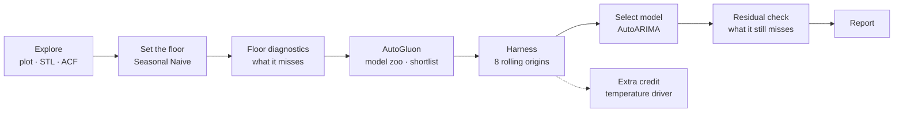

<div align="center">


# Forecasting International Air Passengers

**An end-to-end time-series forecasting project — from exploration to an honest, cross-validated forecast**

[](https://colab.research.google.com/github/Layanharbi9/air-passengers-forecasting/blob/main/project.ipynb)


**Layan Mohammed Alharbi** · Capstone project, Time Series course · [@SDAIAAcademy](https://github.com/SDAIAAcademy)

[Dataset](#1-the-dataset) · [Pipeline](#3-the-pipeline) · [Exploration](#5-exploration--what-the-series-looks-like) · [Harness](#8-the-harness--the-real-test-8-years) · [Best model](#9-the-best-model--autoarima) · [Report](report.md) · [Notebook](project.ipynb)

</div>

---

## Overview

This is my capstone project for the **[@SDAIAAcademy](https://github.com/SDAIAAcademy) Time Series course**:
the full forecasting pipeline, start to finish, on the Box & Jenkins **AirPassengers** series — exploration,
decomposition, a benchmark floor, a model zoo through a framework (AutoGluon), rolling-origin
cross-validation, residual diagnostics, a dynamic-regression extension, and a report written for a manager.

<table>
<tr>
<td align="center" width="25%"><h2>−51%</h2><sub>forecast error against the benchmark<br/><b>MASE 0.65 vs 1.31</b></sub></td>
<td align="center" width="25%"><h2>7 of 8</h2><sub>test years in which the model<br/><b>beats the benchmark</b></sub></td>
<td align="center" width="25%"><h2>−45%</h2><sub>better forecast distribution<br/><b>scaled CRPS 0.034 vs 0.062</b></sub></td>
<td align="center" width="25%"><h2>6.04 M</h2><sub>passengers forecast for 1961<br/><b>against 5.71 M in 1960</b></sub></td>
</tr>
</table>

> [!TIP]
> **Recommendation:** ship the seasonal ARIMA model (**AutoARIMA**). Across eight rolling test years it cuts
> the error of the "copy last year" benchmark roughly **in half** (MASE 0.65 vs 1.31), and it is also the
> best model on the whole forecast distribution, not only on the point forecast.

> [!WARNING]
> **Caveat:** its 80% prediction band contained **70%** of the actual months, not 80%. The band is too
> narrow because the model's errors grow with the traffic. Until the next step (a log transform) is in
> place, the 80% band should be read as a band of roughly 70%.

| | |
|---|---|
| **Author** | Layan Mohammed Alharbi |
| **Academy** | [@SDAIAAcademy](https://github.com/SDAIAAcademy) — Time Series course capstone |
| **Notebook** | [`project.ipynb`](project.ipynb) — runs top to bottom in about 30 seconds |
| **Report** | [`report.md`](report.md) — 2–3 pages, written for a manager |

---

## Contents

1. [The dataset](#1-the-dataset)
2. [The problem](#2-the-problem)
3. [The pipeline](#3-the-pipeline)
4. [Techniques, models, metrics and tools](#4-techniques-models-metrics-and-tools--and-why-each-one)
5. [Exploration](#5-exploration--what-the-series-looks-like)
6. [The floor](#6-the-floor--and-what-it-leaves-on-the-table)
7. [The framework — AutoGluon](#7-the-framework--autogluon)
8. [The harness](#8-the-harness--the-real-test-8-years)
9. [The best model](#9-the-best-model--autoarima)
10. [Extra credit — dynamic regression](#10-extra-credit--does-weather-drive-traffic)
11. [Conclusions](#11-conclusions)
12. [Requirements coverage](#12-requirements-coverage)
13. [How to run](#how-to-run)

---

## 1. The dataset

### What it is

**AirPassengers** is the classic Box & Jenkins airline series: the **monthly totals of international
airline passengers from January 1949 to December 1960**, recorded in **thousands of passengers**. It was
published as *Series G* in Box & Jenkins, *Time Series Analysis: Forecasting and Control*, and it is one of
the most-studied series in forecasting, because it combines a strong trend with a seasonal pattern whose
size grows over time.

| property | value |
|---|---|
| Period | January 1949 – December 1960 |
| Frequency | monthly |
| Observations | 144 (12 years × 12 months), no gaps, no missing values |
| Unit | thousands of passengers per month |
| Range | 104k (November 1949) to 622k (July 1960) |
| Mean | 280k passengers per month |
| Yearly totals | 1.52 million (1949) → 5.71 million (1960) |
| Availability | public dataset, distributed with R's `datasets` package |

### Links

| source | link |
|---|---|
| R documentation (official description) | [stat.ethz.ch — AirPassengers](https://stat.ethz.ch/R-manual/R-devel/library/datasets/html/AirPassengers.html) |
| Rdatasets page (the copy the notebook downloads) | [vincentarelbundock.github.io/Rdatasets — AirPassengers](https://vincentarelbundock.github.io/Rdatasets/doc/datasets/AirPassengers.html) |
| Raw CSV | [AirPassengers.csv](https://vincentarelbundock.github.io/Rdatasets/csv/datasets/AirPassengers.csv) |
| Original reference | Box, G. E. P., Jenkins, G. M. and Reinsel, G. C., *Time Series Analysis, Forecasting and Control*, Holden-Day — Series G |

### How I used it

1. **Loading.** The notebook downloads the series directly with `statsmodels.datasets.get_rdataset("AirPassengers")`,
   which fetches it from the Rdatasets archive. There is no manual download step and no data file to keep in sync.
2. **Conversion to a proper date index.** The raw file stores time as a decimal year (`1949.000`, `1949.083`, …).
   I converted each value into a year and a month and built a real monthly date (`1949-01-01`, `1949-02-01`, …).
3. **Long format.** The series is stored in the standard Nixtla layout used throughout the project —
   `unique_id` (series name), `ds` (month) and `y` (passengers, in thousands) — so the same frame feeds
   statsmodels, statsforecast and the course scoring harness.
4. **Hand conversion for AutoGluon.** For the framework section, the same frame is renamed by hand
   (`unique_id → item_id`, `ds → timestamp`, `y` as target) into AutoGluon's `TimeSeriesDataFrame`.
5. **Splitting for evaluation.** The data is never split only once. It is evaluated with **rolling origins**: the
   models are refitted at the end of each year from 1952 to 1959 and forecast the following 12 months, so
   every year from 1953 to 1960 serves once as a test year, and each fit sees only the months before its cutoff.
6. **The driver (extra credit).** For the dynamic-regression extension, I sourced a second dataset —
   monthly mean temperature at New York (JFK) from the
   [Open-Meteo historical weather archive](https://open-meteo.com/en/docs/historical-weather-api) (ERA5
   reanalysis, free, no API key). Daily values for 1949–1960 were averaged to monthly values and cached in
   [`data/temperature_nyc_monthly.csv`](data/temperature_nyc_monthly.csv) (144 rows, −3.6 °C to 25.7 °C), so the
   notebook does not depend on the API being available.

---

## 2. The problem

| | |
|---|---|
| **Data** | monthly international airline passengers, January 1949 – December 1960 (144 months, thousands) |
| **Goal** | forecast the next 12–24 months, and prove the forecast is better than the simplest sensible alternative — with honest uncertainty bands, not only a single number |
| **Principle** | *the process, not the number* — an honest analysis is worth more than a lucky score |

**Rules of the project:**

- **Harness only** — every result comes from a rolling-origin test (many forecast origins, not one lucky holdout).
- **A benchmark floor** — every model is compared against the simplest seasonal forecast.
- **Scored intervals** — the uncertainty band is evaluated, not only the point forecast.
- **No leakage** — no fit, feature or scaling denominator is allowed to see data from the future.

---

## 3. The pipeline



| step | method | tools |
|---|---|---|
| Exploration | time plot, STL decomposition, trend and seasonal strength, ACF | statsmodels |
| The floor | Seasonal Naive, plus Naive and Naive with drift as extra benchmarks | statsforecast |
| Floor diagnostics | residuals `y_t − y_{t−12}`, their ACF, 80% coverage | coursekit |
| Framework | hand-written conversion to `TimeSeriesDataFrame`, a zoo of 5 local models plus an ensemble, leaderboard | autogluon.timeseries |
| Harness | 8 rolling origins, h = 12, step = 12 (forecasts 1953 → 1960) — MASE, RMSSE, scaled CRPS, 80% coverage | statsforecast, coursekit.scoring |
| Best model | 24-month forecast with 80% / 95% bands, residual plot and ACF | statsforecast, matplotlib |
| Extra credit | ARIMA with a temperature regressor, leakage-free per fold | Open-Meteo archive, statsforecast |

---

## 4. Techniques, models, metrics and tools — and why each one

### Techniques

| technique | what it does | why I used it |
|---|---|---|
| Time plot | draws the series over time | the first look: shows the growth, the yearly pattern, and that the swing grows with the level |
| STL decomposition (Seasonal-Trend decomposition using Loess) | splits the series into trend, seasonal and remainder | to see which component does the work and whether the season is additive or multiplicative |
| Trend and seasonal strength (Hyndman & Athanasopoulos) | turns the decomposition into two numbers between 0 and 1 | to decide objectively what a model must contain — both came out close to 1 |
| ACF (autocorrelation function) | measures how much the series resembles itself *k* months earlier | the spike at lag 12 confirms the yearly season; on residuals it shows what pattern a model left behind |
| Residual analysis | inspects the errors a model leaves (plot, ACF, histogram) | tells what a model missed (trend, momentum, season) and therefore which model can fix it |
| Prediction intervals (20 / 40 / 60 / 80 / 95%) | a range around the forecast instead of one number | a manager needs the uncertainty, not only the estimate; the 80% band is the one checked for honesty |
| Rolling-origin cross-validation (8 origins, h = 12, step = 12) | forecasts 12 months ahead from 8 different year-ends and scores each | one holdout year can be lucky; eight years give a ranking that can be trusted and show the spread of results |
| Leakage-free folds | every fit, scaling denominator and driver value uses only data before the cutoff | otherwise the test "sees the future" and the scores are not real |
| Dynamic regression (regression with ARIMA errors) | adds an external variable (temperature) to the model | tests whether a real-world driver adds information beyond the calendar |
| Climatology for future regressors | uses the average temperature per month from past years as the "future" value | the real future temperature is unknown at forecast time — using it would be leakage |

### Models

| model | type | why it is in the project |
|---|---|---|
| **Seasonal Naive** — the floor | benchmark: next month = same month last year | the minimum any model must beat; the natural floor for monthly data with a yearly season |
| Naive | benchmark: next month = this month | a second benchmark without a season — shows what ignoring seasonality costs |
| Naive with drift (RWD) | benchmark: extends the average growth line | a benchmark with a trend but no season — the opposite gap to the floor |
| **AutoARIMA** (selected) | seasonal ARIMA, orders chosen automatically | handles trend (differencing), season (seasonal differencing) and momentum (AR terms) — exactly what the floor leaves behind. Selected model: `ARIMA(1,1,0)(0,1,0)[12]` |
| AutoETS | exponential smoothing (level / trend / season states) | the other classic family for trended seasonal data; can model multiplicative seasonality |
| AutoTheta | Theta method on the seasonally adjusted series | a strong, simple, competition-winning method — a fair third candidate |
| WeightedEnsemble (AutoGluon) | a weighted combination of the zoo's models | built automatically by AutoGluon; tests whether combining beats any single model |
| AutoARIMA + temperature | dynamic regression | extra credit: does weather explain passenger numbers beyond the season? |

### Metrics

| metric | what it measures | better | why |
|---|---|:---:|---|
| **MASE** (Mean Absolute Scaled Error) | average error relative to the seasonal-naive error on the training data; below 1 beats the floor | lower | the course's main point-accuracy metric; scale-free and directly comparable to the floor |
| **RMSSE** (Root Mean Squared Scaled Error) | like MASE, but squares the errors so large misses weigh more | lower | checks that the ranking is not hiding a few large misses |
| **Scaled CRPS** (Continuous Ranked Probability Score) | quality of the whole forecast distribution (all interval levels) | lower | a forecast is a range, not a point; MASE alone is half a result |
| **80% coverage** | share of actual months that fell inside the 80% band | closest to 80% | the honesty check: an 80% band should contain the truth about 80% of the time |
| **80% band width** | average size of the band | narrower, if honest | coverage alone can be inflated by a very wide band; width shows the price paid for it |

> [!NOTE]
> There is no "accuracy %" in forecasting — accuracy is a classification metric. Forecasts are judged by
> **how far off** they are (MASE, RMSSE), **how good the range** is (CRPS) and **whether the range is honest** (coverage).

### Libraries and tools

| tool | used for | why this one |
|---|---|---|
| Python 3.12 | everything | the course language |
| pandas / NumPy | data handling and calculations | the standard data stack |
| statsmodels | loading the dataset, STL decomposition, ACF | the reference implementation of classical time-series tools |
| statsforecast (Nixtla) | fitting the floor and the shortlist, rolling-origin cross-validation with intervals | fast, consistent models with built-in cross-validation and prediction intervals — the course harness |
| utilsforecast | MASE, RMSSE, scaled CRPS | the loss functions behind the course's scoring module |
| AutoGluon (timeseries) | the model zoo and leaderboard | the course's framework: fits many models in one call, used here to shortlist |
| coursekit (course package) | course plots and `score_cv` scoring | the academy's harness — guarantees each fold is scored only on data it was allowed to see |
| matplotlib / seaborn | all charts | every chart is saved to `figures/` and reused in the report |
| Open-Meteo archive API | historical monthly temperature (New York, JFK) | free, no key, ERA5 reanalysis going back to 1940 — cached as a CSV |
| Jupyter / Google Colab | running the notebook | the notebook must run top to bottom on Colab |
| Git and GitHub | version control and publishing | the project is delivered as a repository |

---

## 5. Exploration — what the series looks like

<table>
<tr>
<td width="50%"></td>
<td width="50%"></td>
</tr>
<tr>
<td valign="top"><b>Time plot.</b> Steady growth from about 127k passengers per month (1949 average) to about 476k (1960 average). Every year peaks in July–August and dips in November.</td>
<td valign="top"><b>STL decomposition.</b> The trend does most of the work; the seasonal component keeps the same shape but its amplitude grows almost fivefold; the remainder is small but larger in later years.</td>
</tr>
</table>

**The key detail:** the summer swing grows with the traffic — the gap between the best and worst month went from
**44k in 1949 to 232k in 1960** — so the seasonality is **multiplicative**: a share of the level, not a fixed amount.

| measure | value | what it implies for model choice |
|---|:---:|---|
| Trend strength | **1.00** | a model must carry a trend |
| Seasonal strength | **0.99** | a model must carry a season |

<p align="center"></p>

**ACF of the raw series:** slow decay at every lag (the trend), with bumps at lags 12 and 24 (the yearly season).

> **The shape in one sentence:** *"The number keeps going up, and every month looks a lot like the same month a year earlier."*

---

## 6. The floor — and what it leaves on the table

The seasonal naive forecast (*next January = last January*) is the benchmark every model has to beat.
Naive and Naive with drift were fitted alongside it as additional benchmarks.

<p align="center"></p>

| structure left in the floor's residuals | finding | which model captures it |
|---|---|---|
| Trend | residuals average **+32k**, not zero | a model with differencing or a trend state |
| Low-lag autocorrelation | ACF ≈ **0.75, 0.65, 0.50** at lags 1–3 | an AR term |
| Seasonality (lag 12) | ACF ≈ **−0.04** — fully used | nothing more needed |

**Interval honesty:** the floor's band claims 80% but covers only **51%** of the tested months, so it is
**not honest**. Its error is the missing trend, which is systematic rather than random.

---

## 7. The framework — AutoGluon

The data was converted to AutoGluon's format **by hand and visibly** (`unique_id → item_id`, `ds → timestamp`,
`y` as target), and a zoo of **five local models** was fitted — Naive, SeasonalNaive, AutoETS, AutoARIMA,
Theta — plus a **WeightedEnsemble**. The leaderboard below is scored on the held-out months of 1960.

| model | score_test (1960) | score_val (1959) |
|---|:---:|:---:|
| **AutoARIMA** | **−0.61** | −1.58 |
| Theta | −0.88 | −1.63 |
| WeightedEnsemble | −0.93 | **−1.54** |
| AutoETS | −1.17 | −1.55 |
| SeasonalNaive | −1.57 | −1.66 |
| Naive | −2.50 | −3.20 |

**Reading the leaderboard:**

- **Sign.** The scores are negative because AutoGluon reports error metrics with the sign flipped
  (higher is better): −0.61 means MASE 0.61.
- **Windows.** `score_val` is computed on **one** 12-month validation window — and the ranking changes between
  1959 (ensemble and ETS first) and 1960 (ARIMA first).
- **What it can and cannot do.** The leaderboard is good for **shortlisting** (every trend-plus-season model beats both
  naive models) but cannot be trusted to **rank** them. That is why the shortlist goes to the harness.

---

## 8. The harness — the real test (8 years)

Every model forecasts 12 months ahead from **8 different origins** (end of 1952, 1953, …, 1959), on exactly the
**same folds as the floor**, through the course scoring harness.

| rank | model | MASE ↓ | RMSSE ↓ | scaled CRPS ↓ | 80% coverage | 80% band width |
|:---:|---|:---:|:---:|:---:|:---:|:---:|
| 1 | **AutoARIMA** | **0.647** | **0.683** | **0.034** | **69.8%** | 44k |
| 2 | AutoTheta | 0.898 | 0.988 | 0.046 | 59.4% | 58k |
| 3 | AutoETS | 0.952 | 1.003 | 0.050 | 49.0% | 49k |
| 4 | Seasonal Naive (floor) | 1.313 | 1.246 | 0.062 | 51.0% | 78k |
| 5 | Naive with drift | 1.813 | 2.156 | 0.095 | 76.0% | 149k |
| 6 | Naive | 2.119 | 2.452 | 0.110 | 68.8% | 143k |

<p align="center"></p>

**Analysis against the floor:**

| | finding |
|---|---|
| Point forecast | AutoARIMA reduces the error by **51%** (MASE 0.647 vs 1.313) |
| Distribution | AutoARIMA improves the scaled CRPS by **45%** (0.034 vs 0.062) |
| Year by year | AutoARIMA beats the floor in **7 of 8 years**; it loses only in **1958**, the year growth stalled and copying 1957 was nearly perfect |
| Split result | **AutoETS** beats the floor on accuracy, but its band covers *less* than the floor's (49% vs 51%) — a win on the point and a loss on the interval |
| Coverage verdict | only Naive with drift lands in the honest range (76%), and only by being about 3× wider while forecasting worse. Every useful model is too narrow; AutoARIMA is closest (70%). The misses come a whole year at a time (1955: 50%, 1959: 0%) — years when growth jumped above trend |

---

## 9. The best model — AutoARIMA

**Selected model:** `ARIMA(1,1,0)(0,1,0)[12]` — one regular difference (removes the trend), one seasonal
difference (removes the season) and one AR term (the month-to-month momentum the floor left behind).

<p align="center"></p>

- **1961 forecast:** **6.04 million** passengers (against 5.71 million in 1960).
- **Interval width** — the band widens with the horizon:

| horizon | 80% band width |
|---|:---:|
| month 1 | 30k |
| month 12 | 82k |
| month 24 | 181k |

### Residuals — what the model still misses

<p align="center"></p>

- The residuals are **centred on zero** and show **no pattern** at lags 1–3, 12 or 24 — the trend and the momentum were absorbed.
- One crossing at **lag 23** (0.28 against a band of ±0.17) is the roughly 1-in-24 false alarm expected by chance.
- The residuals are about **1.5× larger in 1957–60 than in 1950–53**. The model works on raw counts, so it
  assumes an error costs the same number of passengers in every year — which is why its band is too narrow in
  the busy years.

---

## 10. Extra credit — does weather drive traffic?

**Driver:** monthly mean temperature at New York (JFK) from the Open-Meteo historical archive, cached in
[`data/temperature_nyc_monthly.csv`](data/temperature_nyc_monthly.csv) (see [the dataset section](#1-the-dataset)).

**Model:** AutoARIMA with temperature as a regressor — a regression with ARIMA errors, evaluated on the same eight origins.

**No leakage:** the future temperature is unknown at forecast time, so each fold uses the **monthly climatology
computed only from its own training years** as its future regressor. The fit, the climatology and the MASE
denominator all see only data up to the cutoff.

| model | MASE | scaled CRPS | 80% coverage |
|---|:---:|:---:|:---:|
| AutoARIMA (harness) | **0.647** | 0.034 | 69.8% |
| AutoARIMA + temperature | 0.665 | 0.034 | 70.8% |

**Result:** temperature does **not** help (coefficient +0.80k passengers per °C). It mostly repeats the seasonal
pattern that seasonal differencing already removes. A useful driver must carry information the calendar does not
— fares, income or route capacity are better candidates.

---

## 11. Conclusions

1. **Ship AutoARIMA** — it halves the benchmark's error over eight test years and is the best model on the full distribution.
2. **Read its 80% band as roughly a 70% band** until the next step is in place.
3. **Next step:** model the **logarithm** of passengers, so errors scale with the traffic. Expected effect: a
   similar forecast, a band that is narrower in quiet years and wider in busy ones, and coverage moving toward 80%.
4. **One holdout is not a ranking** — AutoGluon's single-window leaderboard changed between two neighbouring years;
   only the eight-year harness settled the order.

---

## 12. Requirements coverage

How the project covers each part of the course [rubric](https://github.com/SDAIAAcademy/international-airpassengers-project/blob/main/rubric.md):

| part | requirement | where it is covered |
|---|---|---|
| **A — Exploration** | time plot with trend and seasonality in plain language | [§5](#5-exploration--what-the-series-looks-like) · notebook §1 |
| | STL decomposition, all three panels read | [§5](#5-exploration--what-the-series-looks-like) · notebook §1 |
| | trend and seasonal strength with their implication | [§5](#5-exploration--what-the-series-looks-like) · notebook §1 |
| | ACF of the raw series, lag 12 explained, shape in one sentence | [§5](#5-exploration--what-the-series-looks-like) · notebook §1 |
| **B — The floor** | seasonal naive plus other benchmarks | [§6](#6-the-floor--and-what-it-leaves-on-the-table) · notebook §2 |
| | floor residuals `y_t − y_{t−12}` and their ACF, structure left and which model captures it | [§6](#6-the-floor--and-what-it-leaves-on-the-table) · notebook §2 |
| | the floor's interval and its 80% coverage | [§6](#6-the-floor--and-what-it-leaves-on-the-table) · notebook §2 |
| **C — The framework** | hand-written conversion to AutoGluon's frame | [§7](#7-the-framework--autogluon) · notebook §3 |
| | a zoo of several models, leaderboard on held-out months | [§7](#7-the-framework--autogluon) · notebook §3 |
| | sign of `score_val`, number of windows, what the ranking can and cannot do | [§7](#7-the-framework--autogluon) · notebook §3 |
| **D — The harness** | same 8 origins, h = 12, step = 12 as the floor | [§8](#8-the-harness--the-real-test-8-years) · notebook §4 |
| | one table with MASE, scaled CRPS and 80% coverage per model | [§8](#8-the-harness--the-real-test-8-years) · notebook §4 |
| | wins and losses per metric, coverage verdict | [§8](#8-the-harness--the-real-test-8-years) · notebook §4 |
| **E — The report** | recommendation with evidence; intervals; residuals; one next step; written for a manager | [`report.md`](report.md) · notebook §4b and §5 |
| **Extra credit** | dynamic regression on a sourced, cached driver, with the cross-validation discipline | [§10](#10-extra-credit--does-weather-drive-traffic) · notebook §6 |

**Rules respected:** every reported number comes from the rolling-origin harness; MASE is always reported with
CRPS and coverage; the floor is present and compared; intervals appear in the notebook and the report; and no
fit, feature or denominator uses data beyond its fold's cutoff.

---

## How to run

**Google Colab:** click the *Open in Colab* badge at the top and run all cells. The first cell clones this
repository and installs the dependencies (AutoGluon is installed automatically when section 3 is reached).

**Locally** (Python 3.11 – 3.13):

```bash
git clone https://github.com/Layanharbi9/air-passengers-forecasting.git
cd air-passengers-forecasting
python -m venv .venv && source .venv/bin/activate
pip install -e . "autogluon.timeseries" jupyter
jupyter nbconvert --to notebook --execute project.ipynb   # about 30 seconds
```

## Repository contents

| file | description |
|---|---|
| [`project.ipynb`](project.ipynb) | the full analysis, from data loading to extra credit |
| [`report.md`](report.md) | the 2–3 page report for a manager |
| [`figures/`](figures/) | every chart, saved by the notebook and used in the report |
| [`data/temperature_nyc_monthly.csv`](data/temperature_nyc_monthly.csv) | cached temperature driver for the extra credit |
| [`coursekit/`](coursekit/) | the course's plotting and scoring harness (SDAIA Academy) |
| [`pyproject.toml`](pyproject.toml) | project dependencies |

---

<div align="center">

**Layan Mohammed Alharbi**

Capstone project for the Time Series course · [@SDAIAAcademy](https://github.com/SDAIAAcademy)

[](https://github.com/Layanharbi9)
[](https://linkedin.com/in/layan-alharbi-b65a78363)
[](https://layanharbi9.github.io/)

<sub>Data: Box & Jenkins, Series G (AirPassengers) · Temperature: Open-Meteo / ERA5 · Course materials and <code>coursekit</code> © SDAIA Academy</sub>

</div>
